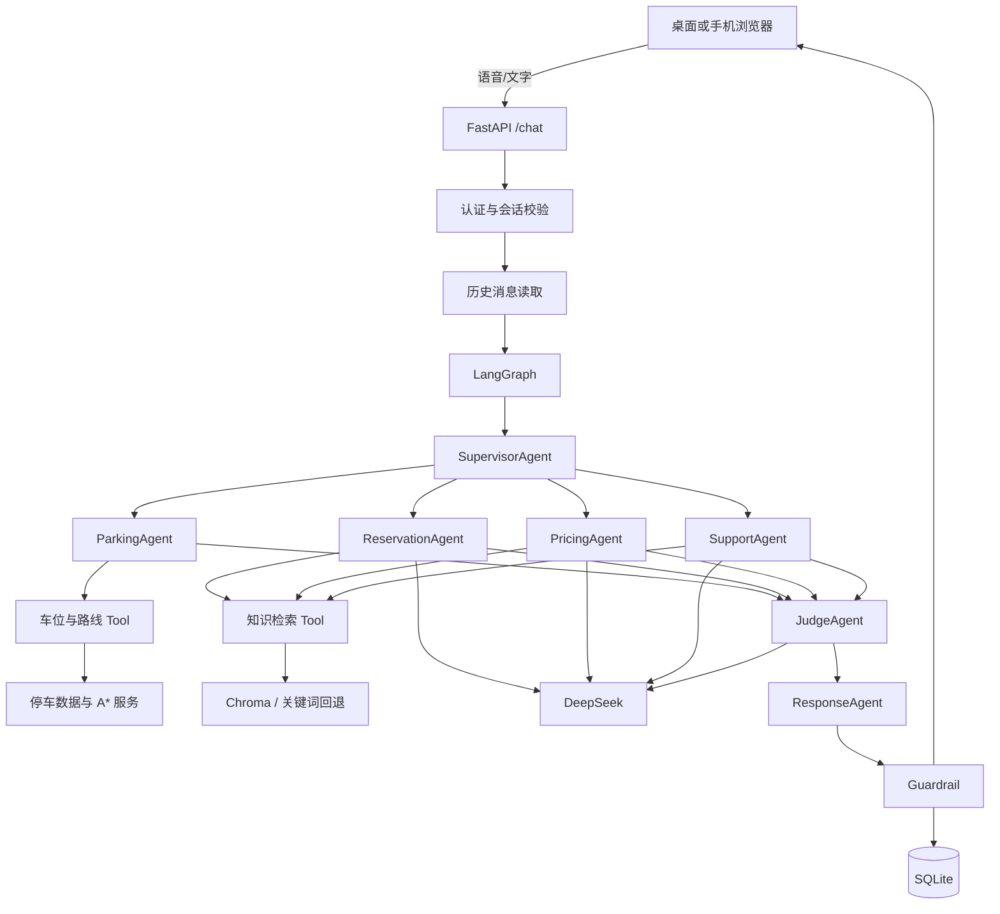
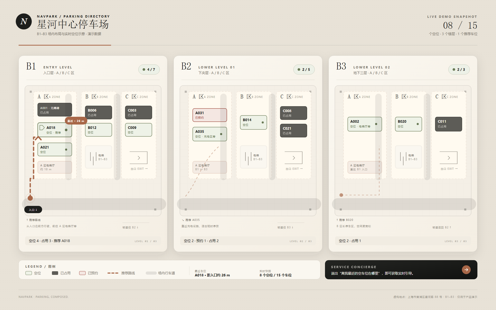
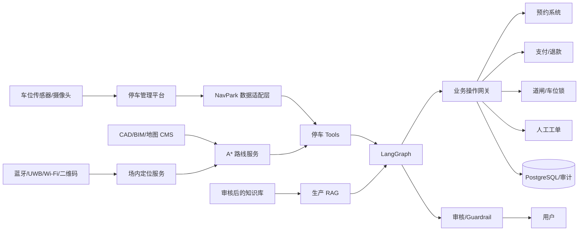

# NavPark 智能停车场助手

[](LICENSE)
[](https://www.python.org/)
[](https://fastapi.tiangolo.com/)
[](https://www.langchain.com/langgraph)

NavPark 是一个面向地下停车场的开源 AI 停车礼宾项目，使用 FastAPI、LangGraph、DeepSeek、SQLite、A* 路网搜索和原生 Web 前端构建。

项目支持手机号验证码登录、浏览器语音输入、实时车位查询、跨楼层室内导航、动态 SVG 地图、预约/价格/售后问答、回答审核、内容安全检查和聊天记录持久化。

> **项目状态：可运行的演示与参考实现。**
>
> 车位、地图、预约、支付和人工工单目前均为演示逻辑，不能直接用于真实商业停车场运营。真实停车场接入需要连接停车管理平台、场内定位、预约/支付系统和人工客服系统，详见[第 9 章：真实停车场接入](#9-真实停车场接入)。

## 目录

1. [项目介绍](#1-项目介绍)
   - [1.1 项目解决什么问题](#11-项目解决什么问题)
   - [1.2 核心设计原则](#12-核心设计原则)
   - [1.3 演示能力与生产边界](#13-演示能力与生产边界)
2. [快速开始](#2-快速开始)
   - [2.1 环境要求](#21-环境要求)
   - [2.2 Windows 安装](#22-windows-安装)
   - [2.3 macOS / Linux 安装](#23-macos--linux-安装)
   - [2.4 最小配置](#24-最小配置)
   - [2.5 启动与验证](#25-启动与验证)
   - [2.6 第一次使用](#26-第一次使用)
3. [功能说明](#3-功能说明)
   - [3.1 功能完成度](#31-功能完成度)
   - [3.2 多 Agent 工作流](#32-多-agent-工作流)
   - [3.3 Tool 权限设计](#33-tool-权限设计)
   - [3.4 审核与内容安全](#34-审核与内容安全)
4. [系统架构](#4-系统架构)
   - [4.1 整体架构](#41-整体架构)
   - [4.2 请求处理流程](#42-请求处理流程)
   - [4.3 登录与数据存储](#43-登录与数据存储)
   - [4.4 RAG 知识库](#44-rag-知识库)
   - [4.5 技术栈](#45-技术栈)
5. [停车场与 A* 导航](#5-停车场与-a-导航)
   - [5.1 演示停车场](#51-演示停车场)
   - [5.2 起点与车位推荐](#52-起点与车位推荐)
   - [5.3 A* 路线生成](#53-a-路线生成)
   - [5.4 动态室内地图](#54-动态室内地图)
6. [完整配置说明](#6-完整配置说明)
   - [6.1 环境变量](#61-环境变量)
   - [6.2 生成认证密钥](#62-生成认证密钥)
   - [6.3 DeepSeek 配置](#63-deepseek-配置)
   - [6.4 短信配置](#64-短信配置)
   - [6.5 知识库配置](#65-知识库配置)
   - [6.6 手机访问与 HTTPS](#66-手机访问与-https)
7. [API 接口](#7-api-接口)
8. [测试方法](#8-测试方法)
   - [8.1 隔离测试数据](#81-隔离测试数据)
   - [8.2 运行测试](#82-运行测试)
   - [8.3 在线评估](#83-在线评估)
   - [8.4 手工验收清单](#84-手工验收清单)
9. [真实停车场接入](#9-真实停车场接入)
   - [9.1 当前演示与真实系统的差距](#91-当前演示与真实系统的差距)
   - [9.2 推荐目标架构](#92-推荐目标架构)
   - [9.3 实施阶段](#93-实施阶段)
   - [9.4 车位数据契约](#94-车位数据契约)
   - [9.5 真实地图与路网](#95-真实地图与路网)
   - [9.6 场内定位](#96-场内定位)
   - [9.7 预约、支付和道闸](#97-预约支付和道闸)
   - [9.8 代码修改位置](#98-代码修改位置)
   - [9.9 验收与灰度上线](#99-验收与灰度上线)
10. [生产部署](#10-生产部署)
    - [10.1 推荐部署形态](#101-推荐部署形态)
    - [10.2 多实例限制](#102-多实例限制)
    - [10.3 监控与备份](#103-监控与备份)
11. [安全、隐私与合规](#11-安全隐私与合规)
12. [项目结构](#12-项目结构)
13. [常见问题排查](#13-常见问题排查)
14. [当前限制与路线图](#14-当前限制与路线图)
15. [开源许可与贡献](#15-开源许可与贡献)
    - [15.1 参与贡献](#151-参与贡献)
    - [15.2 开源发布检查](#152-开源发布检查)
    - [15.3 许可证](#153-许可证)

---

## 1. 项目介绍

### 1.1 项目解决什么问题

NavPark 面向以下停车场景：

- 用户不知道哪个楼层或区域还有空车位。
- 用户进入地下停车场后难以找到目标车位或出口。
- 用户需要查询停车价格、预约规则、营业时间和售后服务。
- 停车场希望提供语音或文字礼宾，而不是让用户逐层点击菜单。
- 业务方希望使用大模型改善交互，但不允许模型随意编造车位、价格、路线和业务结果。

项目不是简单地把问题直接交给大模型，而是把系统拆成两条链路：

```text
确定性业务链路
车位查询 → A* 路线 → 中文导航步骤 → 事实审核 → 最终回答

知识问答链路
意图识别 → RAG 检索 → DeepSeek 生成草稿 → Judge 审核 → Guardrail → 最终回答
```

### 1.2 核心设计原则

- **事实来自代码。** 车位、距离、楼层、路线和导航步骤由 Python 与 Tool 产生。
- **模型只组织语言。** DeepSeek 负责路由、规则说明和结构化审核，不修改关键业务事实。
- **单 Agent 单一职责。** 路由、停车、预约、价格、售后、审核和回答各自独立。
- **最小工具权限。** Agent 只能使用 `app/tools/access.py` 明确授予的 Tool。
- **失败关闭。** 审核结果不可解析时进入人工待核实，不直接放行。
- **不假装成功。** 没有真实预约、支付或人工系统成功结果时，不得声称操作完成。

### 1.3 演示能力与生产边界

| 能力 | 当前状态 | 说明 |
| --- | --- | --- |
| 手机号注册/登录 | 可运行 | 中国大陆手机号、6 位验证码、HttpOnly Cookie |
| 语音输入 | 可运行 | 浏览器 Web Speech API，后端不处理音频 |
| 文字聊天 | 可运行 | FastAPI `/chat` + LangGraph |
| 车位查询 | 演示数据 | 15 个内存车位，占用 B1–B3 |
| A* 导航 | 可运行 | 固定演示路网，支持跨楼层 |
| 室内地图 | 可运行 | SVG 楼层切换、路线高亮、定时刷新 |
| 预约规则问答 | 依赖配置 | 需要知识和 DeepSeek |
| 价格规则问答 | 依赖配置 | 需要知识和 DeepSeek |
| 售后问答 | 依赖配置 | 需要知识和 DeepSeek |
| 回答审核 | 可运行 | 确定性风险策略 + JudgeAgent |
| 真实预约/支付 | 未实现 | 需接入外部业务系统 |
| 真实道闸/车位锁 | 未实现 | 需接入物联网和审计系统 |
| 真实人工工单 | 未实现 | 目前只返回 `pending` 状态 |
| 运营后台 | 未包含 | 当前仅提供用户端和开发接口 |

## 2. 快速开始

### 2.1 环境要求

- Python 3.10 或更高版本。
- 最新版 Edge、Chrome 或其他现代浏览器。
- Windows、macOS 或 Linux。
- DeepSeek API Key：只有预约、价格、售后等语言生成功能需要。
- 手机语音和定位：通常需要 HTTPS 或运行电脑上的 `localhost`。
- 生产短信：需要可用的 Webhook 短信网关。

### 2.2 Windows 安装

在项目根目录打开 PowerShell：

```powershell
py -3 -m venv .venv
.\.venv\Scripts\Activate.ps1
python -m pip install --upgrade pip
python -m pip install -r requirements.txt
Copy-Item .env.example .env
```

如果 PowerShell 禁止激活脚本，可以只对当前用户调整策略：

```powershell
Set-ExecutionPolicy -Scope CurrentUser RemoteSigned
```

也可以不激活环境，直接使用：

```powershell
.\.venv\Scripts\python.exe -m uvicorn main:app --reload
```

### 2.3 macOS / Linux 安装

```bash
python3 -m venv .venv
source .venv/bin/activate
python -m pip install --upgrade pip
python -m pip install -r requirements.txt
cp .env.example .env
```

### 2.4 最小配置

编辑项目根目录的 `.env`：

```env
APP_ENV=development
DATABASE_PATH=data/navpark.db
AUTH_SECRET=replace_with_a_long_random_secret
COOKIE_SECURE=false

SMS_PROVIDER=console
SMS_CODE_TTL_SECONDS=300
SMS_RESEND_COOLDOWN_SECONDS=60

DEEPSEEK_API_KEY=
DEEPSEEK_MODEL=deepseek-chat
DEEPSEEK_BASE_URL=https://api.deepseek.com
DEEPSEEK_TIMEOUT=60

ENABLE_RAG=true
RAG_TOP_K=3
DOCUMENTS_DIR=documents
```

开发环境可以不立即填写 DeepSeek Key。停车查询和导航仍可使用；预约、价格和售后请求会返回 HTTP 503。

### 2.5 启动与验证

```powershell
uvicorn main:app --reload
```

打开：

- 用户端：`http://127.0.0.1:8000/`
- Swagger API：`http://127.0.0.1:8000/docs`
- 健康检查：`http://127.0.0.1:8000/health`
- 运行配置：`http://127.0.0.1:8000/config`

PowerShell 检查：

```powershell
Invoke-RestMethod http://127.0.0.1:8000/health
Invoke-RestMethod http://127.0.0.1:8000/config
```

### 2.6 第一次使用

1. 打开首页并点击“获取验证码”。
2. 本地 `SMS_PROVIDER=console` 时，验证码会写入后端日志并在开发接口中返回。
3. 完成注册或登录。
4. 输入“离我最近的空车位在哪里？”
5. 输入“帮我导航到 B2 A035 停车位”。
6. 在左侧地图切换 B1、B2、B3 查看路线。
7. 配置 DeepSeek 和知识文档后再测试价格、预约和售后。
8. 输入“我要投诉并申请退款”测试人工待核实提示。

## 3. 功能说明

### 3.1 功能完成度

| 模块 | 已实现内容 |
| --- | --- |
| 认证 | 注册、登录、验证码限流、会话撤销、用户数据隔离 |
| 聊天 | `/chat`、会话历史、Agent 路由、最终回答 |
| 停车 | 车位快照、楼层统计、最近空闲车位 |
| 导航 | 加权路网、跨楼层 A*、转向步骤、预计时间 |
| 地图 | 楼层切换、路线高亮、起点和目的地标记 |
| 知识问答 | 文档加载、Chroma/关键词检索、DeepSeek 回答 |
| 审核 | 风险关键词、未确认业务操作、敏感信息、JSON 审核 |
| Guardrail | 空回答、长度、脏话、PII、停车领域检查 |
| 指标 | 请求、Agent、错误和 Guardrail 进程内指标 |
| 手机访问 | 局域网地址、二维码、HTTPS 安全上下文提示 |

### 3.2 多 Agent 工作流

项目包含 7 个 LangGraph 节点：

| Agent | 职责 | 是否调用 DeepSeek |
| --- | --- | --- |
| `SupervisorAgent` | 路由到停车、预约、价格或售后 | 普通问题调用；停车关键词可走规则 |
| `ParkingAgent` | 查询车位并生成确定性导航回答 | 否 |
| `ReservationAgent` | 解释预约、修改和取消规则 | 是 |
| `PricingAgent` | 解释价格和计费规则 | 是 |
| `SupportAgent` | 处理营业时间、设施、失物和售后 | 是 |
| `JudgeAgent` | 风险策略和结构化模型审核 | 非停车问题通常调用 |
| `ResponseAgent` | 最终回答、Guardrail、持久化 | 否 |

```text
SupervisorAgent
   ├── ParkingAgent ────────┐
   ├── ReservationAgent ────┤
   ├── PricingAgent ────────┤
   └── SupportAgent ────────┤
                            ▼
                       JudgeAgent
                            │
                            ▼
                      ResponseAgent
                            │
                            ▼
                         最终回答
```

这些 Agent 是同一 DeepSeek 客户端上的不同职责节点，不是 7 个独立模型或微服务。

### 3.3 Tool 权限设计

| Tool | 权限 | 自动接入 | 可用 Agent |
| --- | --- | --- | --- |
| `get_parking_availability` | 只读 | 是 | ParkingAgent |
| `plan_parking_route` | 只读、A* | 是 | ParkingAgent |
| `search_parking_knowledge` | 只读 RAG | 是 | Reservation、Pricing、Support |
| `calculate_parking_fee` | 计算 | 否 | PricingAgent |
| `validate_reservation_request` | 参数校验 | 否 | ReservationAgent |

`calculate_parking_fee` 只根据明确提供的费率和时长估算，不会补造价格。

`validate_reservation_request` 只检查时间和车牌格式，始终返回 `reservation_created: false`。

### 3.4 审核与内容安全

最终回答返回前会经过：

1. 确定性高风险关键词检查。
2. 未确认业务操作检查。
3. 敏感信息检查。
4. JudgeAgent 结构化 JSON 审核。
5. 最终 Guardrail 内容检查。

以下情况默认需要人工核实：

- 投诉、退款、重复扣费、支付争议。
- 事故、车辆损坏、火灾、医疗和法律责任。
- 失物、隐私泄露或账号安全。
- 回答声称已经完成预约、支付、退款或开闸，但没有真实成功结果。
- 审核模型输出无法解析或包含无证据事实。

人工核实当前只返回：

```text
human_review_status = pending
```

系统不会假装人工已经介入。

## 4. 系统架构

### 4.1 整体架构



### 4.2 请求处理流程

1. 浏览器向 `POST /chat` 提交问题和可选定位。
2. FastAPI 校验登录 Cookie、同源请求、文本长度和坐标。
3. 服务端解析会话并验证会话归属。
4. 从 SQLite 读取当前用户的历史消息。
5. LangGraph 从 SupervisorAgent 开始执行。
6. 专业 Agent 调用授权 Tool，或使用 RAG 证据调用 DeepSeek。
7. JudgeAgent 审核草稿。
8. ResponseAgent 生成最终回答、执行 Guardrail 并写入数据库。
9. 接口返回答案、审核状态、Tool 结果和 Agent 执行摘要。

### 4.3 登录与数据存储

认证机制包括：

- 仅支持中国大陆手机号。
- 6 位验证码默认 5 分钟有效。
- 同一手机号 60 秒内不能重复发送。
- 同一手机号每小时最多请求 5 次验证码。
- 单个验证码最多尝试 5 次。
- 验证码使用 HMAC-SHA256 摘要保存。
- 登录令牌只保存 SHA-256 摘要。
- 登录 Cookie 使用 `HttpOnly` 和 `SameSite=Lax`。
- 默认会话有效期 30 天。

SQLite 数据表：

| 表 | 用途 |
| --- | --- |
| `users` | 用户和手机号 |
| `sms_codes` | 验证码摘要、有效期和尝试次数 |
| `auth_sessions` | 登录会话摘要和失效时间 |
| `conversations` | 聊天会话归属 |
| `messages` | 用户消息与助手回答 |

浏览器定位只用于当前请求，不写入聊天记录。

### 4.4 RAG 知识库

当前检索流程：

1. 从 `DOCUMENTS_DIR` 加载 `.txt` 文件。
2. 优先使用进程内 ChromaDB。
3. 使用本地 SHA-256 哈希向量。
4. Chroma 不可用时退化为关键词检索。
5. 将检索文本作为预约、价格和售后 Agent 的证据。

当前实现是轻量演示：

- 哈希向量不包含真实语义。
- Chroma 不跨进程持久化。
- 中文关键词回退效果有限。
- 仓库默认不包含业务知识文档。

生产环境应使用正式嵌入模型、持久化向量库、文档版本和生效时间。

### 4.5 技术栈

| 层级 | 技术 |
| --- | --- |
| Web 服务 | FastAPI、Uvicorn |
| 工作流 | LangGraph、LangChain |
| 模型 | DeepSeek OpenAI 兼容接口 |
| 数据校验 | Pydantic |
| 存储 | SQLite |
| 检索 | ChromaDB、哈希向量、关键词回退 |
| 前端 | HTML、CSS、JavaScript、SVG |
| 语音 | 浏览器 Web Speech API |
| 二维码 | `qrcode` |
| HTTP | `httpx` |
| 测试 | pytest、FastAPI TestClient |

`langchain-openai` 只是访问 DeepSeek 兼容接口的客户端适配层，不表示项目调用 OpenAI 模型。

## 5. 停车场与 A* 导航

### 5.1 演示停车场

当前演示车场为虚构的“NavPark 星河中心停车场”，包含 B1、B2、B3 三个地下楼层、15 个车位和 A/B/C 三个停车区域。



初始车位状态：

- 8 个可用车位。
- 6 个已占用车位。
- 1 个已预约车位。

车位定义位于 `app/parking.py` 的 `DEMO_SPOTS`，保存在进程内存中，服务重启后恢复初始状态。

### 5.2 起点与车位推荐

起点选择规则：

1. 请求带浏览器定位且距离停车场入口不超过 500 米时，尝试使用用户定位。
2. 定位换算到场内坐标后位于通道范围内，则创建场内起点。
3. 浏览器定位不包含楼层，场内起点按 B1 估算。
4. 定位无效、太远或不在通道内时回退到停车场入口。
5. 没有定位时从停车场入口出发。

推荐规则：

1. 筛选状态为 `available` 且类型为 `standard` 的车位。
2. 对每个目标车位分别执行 A*。
3. 比较实际路网距离。
4. 选择路线距离最短的可用车位。
5. 返回距离、预计时间、楼层变化和中文步骤。

预计驾驶时间由演示距离和楼层变化估算，不是真实交通仿真。

### 5.3 A* 路线生成

导航图包含：

- 停车场入口。
- A、B、C 区通道节点。
- 坡道节点和跨楼层边。
- 每个车位的接入边。

系统支持以下车位表达：

- `B2-A-035`
- `B2 A035`
- `B2 区 A 035 号`
- 唯一时支持 `A035`

路线会转换为可直接播报的中文步骤，例如：

```text
1. 从 B1 停车场入口出发，向东行驶约 22 米
2. 向左转，向北行驶约 14 米
3. 沿坡道下行至 B2，约 30 米
4. 到达 B2 层 A 区 035 号
```

指定不存在、已占用、已预约或非标准车位时返回错误，不生成假路线。

### 5.4 动态室内地图

前端通过 `/parking/map` 获取楼层、通道、车位和坡道数据，并支持：

- B1、B2、B3 楼层切换。
- 起点、目的地和路线高亮。
- 距离和预计时间显示。
- 浏览器定位刷新。
- 有路线时约每 10 秒刷新一次。

## 6. 完整配置说明

### 6.1 环境变量

| 变量 | 默认值 | 必填 | 说明 |
| --- | --- | --- | --- |
| `DEEPSEEK_API_KEY` | 空 | 非停车问答必填 | DeepSeek API Key |
| `DEEPSEEK_MODEL` | `deepseek-chat` | 否 | 模型名称 |
| `DEEPSEEK_BASE_URL` | `https://api.deepseek.com` | 否 | OpenAI 兼容接口 |
| `DEEPSEEK_TIMEOUT` | `60` | 否 | 模型请求超时秒数 |
| `TEMPERATURE` | `0` | 否 | 模型采样温度 |
| `ENABLE_RAG` | `true` | 否 | 是否启用知识检索 |
| `RAG_TOP_K` | `3` | 否 | 默认检索数量 |
| `DOCUMENTS_DIR` | `documents` | 否 | `.txt` 知识文档目录 |
| `APP_ENV` | `development` | 否 | `development` 或 `production` |
| `DATABASE_PATH` | `data/navpark.db` | 否 | SQLite 数据库路径 |
| `AUTH_SECRET` | 开发默认值 | 生产必填 | 验证码 HMAC 和会话安全密钥 |
| `AUTH_SESSION_DAYS` | `30` | 否 | 登录有效期 |
| `COOKIE_SECURE` | 生产强制 `true` | 生产建议显式设置 | 是否只通过 HTTPS 发送 Cookie |
| `SMS_PROVIDER` | `console` | 否 | `console` 或 `webhook` |
| `SMS_CODE_TTL_SECONDS` | `300` | 否 | 验证码有效期 |
| `SMS_RESEND_COOLDOWN_SECONDS` | `60` | 否 | 验证码重发间隔 |
| `SMS_WEBHOOK_URL` | 空 | Webhook 模式必填 | 短信网关地址 |
| `SMS_WEBHOOK_TOKEN` | 空 | 建议必填 | 短信网关 Bearer Token |
| `MOBILE_BASE_URL` | 空 | 否 | 手机二维码使用的公网地址 |
| `PARKING_API` | `http://localhost:9000` | 否 | 预留变量，当前未接入真实停车系统 |
| `PAYMENT_API` | `http://localhost:9001` | 否 | 预留变量，当前未接入支付系统 |

相对路径按启动进程的工作目录解析。生产环境建议使用绝对路径，并固定服务工作目录。

### 6.2 生成认证密钥

不要在生产环境使用模板值。生成随机密钥：

```powershell
.\.venv\Scripts\python.exe -c "import secrets; print(secrets.token_urlsafe(48))"
```

将结果写入：

```env
AUTH_SECRET=生成的随机字符串
```

建议通过密码管理器或密钥管理系统保存。

### 6.3 DeepSeek 配置

```env
DEEPSEEK_API_KEY=your_deepseek_api_key
DEEPSEEK_MODEL=deepseek-chat
DEEPSEEK_BASE_URL=https://api.deepseek.com
DEEPSEEK_TIMEOUT=60
TEMPERATURE=0
```

注意：

- API Key 不会出现在页面或 `/config` 响应中。
- 修改 `.env` 后必须重启服务。
- 停车查询不依赖 DeepSeek。
- 预约、价格、售后和其他语言生成请求需要 DeepSeek。
- 在线评估脚本会真实调用 DeepSeek，可能产生费用。

### 6.4 短信配置

开发环境：

```env
SMS_PROVIDER=console
```

验证码会打印在后端日志，并通过开发接口返回给前端自动填充。

生产环境：

```env
APP_ENV=production
COOKIE_SECURE=true
SMS_PROVIDER=webhook
SMS_WEBHOOK_URL=https://sms-gateway.example.com/send
SMS_WEBHOOK_TOKEN=replace_with_gateway_token
```

应用发送的 Webhook 请求：

```json
{
  "phone": "+8613800138000",
  "code": "123456",
  "purpose": "register",
  "expires_in": 300,
  "template": "navpark_login_code"
}
```

短信网关应：

- 校验 Bearer Token 或更强的服务认证。
- 在 10 秒内返回 2xx。
- 对重复请求幂等处理。
- 对发送失败返回非 2xx。
- 提供发送量、失败率和延迟监控。

生产环境不能继续使用 `SMS_PROVIDER=console`。

### 6.5 知识库配置

在 `documents/` 下添加 UTF-8 `.txt` 文件：

```text
documents/
├── pricing.txt
├── reservation.txt
├── facilities.txt
├── service-hours.txt
└── lost-and-found.txt
```

示例：

```text
NavPark 星河中心停车场收费标准

1. 小型车辆白天每小时 10 元，首 30 分钟免费。
2. 当日封顶 80 元。
3. 夜间时段和跨日规则以现场公示为准。
4. 本文档为演示资料，不代表真实停车场收费。
```

不要放入未经审批的资料、用户隐私、密钥或不同停车场混用的政策。

### 6.6 手机访问与 HTTPS

Windows 一键启动：

```powershell
.\start-mobile.cmd -ConfigureFirewall
```

脚本会检查环境、端口和防火墙，使用 `0.0.0.0` 启动服务并打印局域网地址。

电脑打开：

```text
http://127.0.0.1:8000/mobile
```

手机和电脑需要连接同一 Wi-Fi。局域网 HTTP 通常只能使用文字聊天；麦克风和精确定位通常需要 HTTPS。

配置公网 HTTPS 地址：

```env
MOBILE_BASE_URL=https://navpark.example.com
```

可选方案包括 Cloudflare Tunnel、Tailscale Serve、Caddy 或 Nginx。

## 7. API 接口

| 方法 | 路径 | 登录 | 说明 |
| --- | --- | --- | --- |
| `POST` | `/auth/sms/request` | 否 | 请求验证码 |
| `POST` | `/auth/sms/verify` | 否 | 验证码登录或注册 |
| `GET` | `/auth/me` | 是 | 当前用户 |
| `POST` | `/auth/logout` | 否 | 退出并撤销会话 |
| `POST` | `/chat` | 是 | 执行 LangGraph 工作流 |
| `GET` | `/parking/availability` | 否 | 车位快照和推荐路线 |
| `GET` | `/parking/route` | 否 | 推荐或指定车位路线 |
| `GET` | `/parking/map` | 否 | 楼层、路网和车位状态 |
| `GET` | `/health` | 否 | 健康检查 |
| `GET` | `/config` | 否 | 非敏感运行配置 |
| `GET` | `/agents` | 否 | Agent 目录 |
| `GET` | `/tools` | 否 | Tool 目录和权限 |
| `GET` | `/metrics` | 否 | 进程内指标 |
| `POST` | `/metrics/reset` | 否 | 重置进程内指标 |
| `GET` | `/mobile` | 否 | 手机二维码入口 |
| `GET` | `/mobile/info` | 否 | 手机访问地址和安全上下文 |
| `GET` | `/mobile/qr.svg` | 否 | SVG 二维码 |
| `GET` | `/docs` | 否 | Swagger UI |

`POST /chat` 示例：

```json
{
  "question": "离我最近的空车位在哪里？",
  "session_id": "可选的会话 UUID",
  "location": {
    "latitude": 31.23075,
    "longitude": 121.47393
  }
}
```

主要响应字段：

| 字段 | 说明 |
| --- | --- |
| `response` | 最终回答 |
| `session_id` | 当前会话 |
| `navigation` | A* 导航数据 |
| `next_agent` | 路由到的 Agent |
| `intent` | 识别意图 |
| `requires_human` | 是否需要人工核实 |
| `human_review_status` | 人工待核实状态 |
| `audit_result` | 审核结果和风险原因 |
| `api_result` | 业务接口结果 |
| `tool_results` | Tool 成功状态、来源和时间 |
| `workflow.plan` | 执行计划 |
| `workflow.trace` | Agent 执行摘要，不含隐藏推理 |

停车接口：

```text
GET /parking/availability?latitude=31.23075&longitude=121.47393
GET /parking/route?spot_id=B2-A-035
```

`latitude` 和 `longitude` 必须同时提供。

`/chat`、验证码和退出接口会检查请求来源。生产反向代理必须保留正确的 `Host`，并正确设置 `X-Forwarded-Proto`。

## 8. 测试方法

### 8.1 隔离测试数据

测试会创建用户和会话。建议使用独立 SQLite 文件，避免写入日常开发数据库。

PowerShell：

```powershell
$env:DATABASE_PATH = Join-Path $env:TEMP "navpark-pytest.db"
$env:SMS_PROVIDER = "console"
$env:APP_ENV = "development"
.\.venv\Scripts\python.exe -m pytest -q
Remove-Item Env:DATABASE_PATH
```

Bash：

```bash
export DATABASE_PATH="/tmp/navpark-pytest.db"
export SMS_PROVIDER="console"
export APP_ENV="development"
.venv/bin/python -m pytest -q
unset DATABASE_PATH
```

### 8.2 运行测试

全部测试：

```powershell
.\.venv\Scripts\python.exe -m pytest -q
```

当前基线为 **54 个测试全部通过**。数量会随代码更新变化。

详细输出：

```powershell
.\.venv\Scripts\python.exe -m pytest -vv
```

按模块测试：

```powershell
.\.venv\Scripts\python.exe -m pytest tests/test_auth.py -q
.\.venv\Scripts\python.exe -m pytest tests/test_navigation.py -q
.\.venv\Scripts\python.exe -m pytest tests/test_parking.py -q
.\.venv\Scripts\python.exe -m pytest tests/test_tools.py -q
.\.venv\Scripts\python.exe -m pytest tests/test_prompts.py tests/test_workflow.py -q
.\.venv\Scripts\python.exe -m pytest tests/test_mobile_access.py tests/test_voice_app.py -q
```

测试覆盖：

- A* 最短路、跨楼层和禁止穿过其他车位。
- 停车查询、定位回退和指定车位错误。
- Tool 参数、返回结构、权限和失败结果。
- Agent 路由、RAG 证据、Judge 审核和人工提示。
- 验证码、登录、退出和用户会话隔离。
- PII、长度、非停车内容和安全兜底。
- 桌面、手机、语音客户端和实时地图静态资源。

### 8.3 在线评估

```powershell
.\.venv\Scripts\python.exe tests/test_eval.py
```

该脚本会真实调用 DeepSeek，评估回答质量、Agent 路由和 Guardrail 行为。

运行前必须配置 `DEEPSEEK_API_KEY`，并接受可能产生的费用。在线评估结果不能代替真实停车场业务验收。

### 8.4 手工验收清单

#### 认证

- [ ] 未登录访问聊天接口返回 401。
- [ ] 新手机号可以注册。
- [ ] 已注册手机号不能重复注册。
- [ ] 错误验证码不会登录。
- [ ] 发送验证码有冷却限制。
- [ ] 用户 A 无法读取用户 B 的会话。
- [ ] 退出后旧 Cookie 失效。

#### 停车与导航

- [ ] `/health` 返回 `healthy: true`。
- [ ] 无定位时从停车场入口规划。
- [ ] 场内定位可以生成 B1 起点。
- [ ] 500 米外定位回退到入口。
- [ ] 推荐车位状态为 available。
- [ ] 指定 B2 A035 可以生成路线。
- [ ] 指定不可用车位返回错误。
- [ ] 地图可以切换 B1、B2、B3。

#### 问答与安全

- [ ] 没有知识文档时不会编造具体价格。
- [ ] 添加文档后回答与文档一致。
- [ ] 未配置 DeepSeek 时停车查询仍可用。
- [ ] 投诉、退款、事故和失物会标记人工。
- [ ] 系统不声称人工已处理。
- [ ] 系统不声称已预约、已退款或已开闸。

#### 移动端

- [ ] 手机与电脑在同一 Wi-Fi 下可以访问。
- [ ] `/mobile` 能显示二维码。
- [ ] 局域网 HTTP 下文字聊天可用。
- [ ] HTTPS 下语音和定位可用。

## 9. 真实停车场接入

> 将 `DEMO_SPOTS` 替换成接口地址并不等于完成真实停车场接入。必须同时处理数据时效、地图测绘、楼层定位、真实交易、权限、幂等、审计、降级和现场验收。

### 9.1 当前演示与真实系统的差距

| 领域 | 当前演示 | 真实系统要求 |
| --- | --- | --- |
| 车位状态 | 15 个内存对象 | PIS/PMS、传感器或停车平台实时数据 |
| 坐标 | 固定入口和虚拟局部坐标 | 真实经纬度、测绘坐标系和楼层基准 |
| 地图 | 固定通道锚点 | CAD、BIM 或现场核验的矢量图 |
| 楼层 | B1–B3 固定坡道 | 真实坡道、电梯、消防门和限行区 |
| 定位 | 浏览器 GPS 后默认 B1 | 蓝牙、UWB、Wi-Fi、二维码或人工选层 |
| 路线 | 静态距离权重 | 拥堵、封路、单向、限高、限宽和车型 |
| 预约 | 规则说明 | 真实库存、订单、确认和取消 |
| 价格 | 知识文档或估算 | 费率、会员、优惠、封顶、跨日和计费系统 |
| 支付 | 无 | 下单、回调、验签、退款、发票和对账 |
| 道闸 | 无 | 开闸授权、状态、幂等和审计 |
| 人工 | `pending` 状态 | 工单、派单、处理结果和回访 |
| 存储 | SQLite | PostgreSQL、Redis、队列和备份 |
| 部署 | 单机 Uvicorn | HTTPS 网关、监控、容灾和发布流程 |

### 9.2 推荐目标架构



### 9.3 实施阶段

#### 阶段 1：明确业务边界

先确认：

1. 停车场数量、楼层和车位规模。
2. 车位状态：可用、占用、预约、故障、施工、禁停、未知。
3. 车位类型：标准、无障碍、充电、月租、VIP、大型车。
4. 用户能否预约具体车位，还是只能预约入场资格。
5. 预约、支付、退款、开票和开闸分别由哪个系统负责。
6. 定位硬件类型、精度、刷新频率和覆盖范围。
7. 必须强制人工处理的业务。
8. 手机号、车牌、定位和聊天记录的保存期限。

#### 阶段 2：盘点外部系统

| 系统 | 典型能力 |
| --- | --- |
| 停车管理平台 | 车位状态、车牌、入场记录、区域和楼层 |
| 车位传感器 | 单点占用状态、在线状态和上报时间 |
| 预约系统 | 库存、创建、修改、取消和查询 |
| 计费系统 | 费率、优惠、试算、订单 |
| 支付系统 | 下单、回调、查单、退款和发票 |
| 道闸/车位锁 | 开闸、落锁、状态和操作审计 |
| 地图/CMS | 楼层图、通道、区域、坡道和封路 |
| 室内定位 | 楼层、坐标、精度和时间戳 |
| 短信平台 | 验证码模板、回执和失败原因 |
| 人工客服 | 创建工单、查询、通知和关闭 |

每个接口都要明确认证、状态枚举、时区、超时、重试、限流、幂等、错误码、测试环境和变更策略。

#### 阶段 3：建立车位数据适配层

建议增加：

```text
ParkingDataProvider
├── DemoParkingProvider
├── HttpParkingProvider
├── MqttParkingProvider
└── DatabaseParkingProvider
```

不要让 Agent 直接依赖厂商字段，应统一为稳定模型。

常见接入方式：

- **HTTP 轮询：** 按业务要求每 2–10 秒拉取快照，缓存最后一次有效数据。
- **MQTT/Kafka/Webhook：** 消费实时事件，处理乱序、去重、积压和重放。
- **同步数据库：** 外部数据先进入 PostgreSQL 或 Redis，Tool 查询规范化服务。

必须保留：

- 来源系统。
- 数据原始时间和接收时间。
- 数据有效期。
- 传感器健康状态。
- 地图版本。
- 外部请求追踪 ID。

#### 阶段 4：定义数据时效与失败策略

推荐状态：

- `available`
- `occupied`
- `reserved`
- `blocked`
- `out_of_service`
- `unknown`
- `stale`

关键规则：

- 传感器离线时不能默认视为可用。
- 数据过期时不能继续推荐具体车位。
- 未知枚举按保守状态处理并告警。
- 车位 ID 必须稳定，不能依赖显示顺序。
- 金额和时间必须携带币种、时区和业务日期。

故障策略：

| 故障 | 推荐行为 |
| --- | --- |
| 车位数据超时 | 不推荐具体空位，提示查看现场引导 |
| 传感器离线 | 标记 `unknown`，不放行 |
| 地图服务失败 | 只返回入口指引，不生成假路线 |
| 定位失败 | 询问楼层或从入口开始 |
| DeepSeek 超时 | 停车链路继续；其他回答明确失败 |
| 审核模型失败 | 高风险回答不放行 |
| 预约超时 | 返回结果未知，禁止盲目重试创建 |
| 支付回调重复 | 幂等去重并核对订单 |
| 道闸失败 | 明确失败并提示现场人工处理 |
| 工单失败 | 不声称已转人工 |

### 9.4 车位数据契约

建议规范化结构：

```json
{
  "lot": {
    "id": "lot-shanghai-001",
    "name": "示例停车场",
    "timezone": "Asia/Shanghai"
  },
  "spot": {
    "id": "B2-A-035",
    "stable_id": "vendor-spot-39817",
    "level": "B2",
    "zone": "A",
    "number": "035",
    "kind": "standard",
    "status": "available",
    "restrictions": [],
    "x_m": 26.0,
    "y_m": 42.0,
    "sensor_id": "sensor-001",
    "sensor_health": "online",
    "last_reported_at": "2026-10-25T10:00:03+08:00"
  },
  "source": "vendor-pis",
  "as_of": "2026-10-25T10:00:04+08:00",
  "fresh_for_seconds": 5,
  "is_demo_data": false
}
```

Tool 和接口需要明确返回 `ok`、`source`、`as_of`、`fresh_for_seconds` 和错误码。

### 9.5 真实地图与路网

真实路网制作步骤：

1. 获取每层 CAD、BIM 或平面图。
2. 与现场确认入口、出口、坡道、电梯、消防门和禁行区。
3. 为通道建立节点和边。
4. 将每个车位连接到最近通道。
5. 为跨层坡道建立显式楼层边。
6. 增加单向、限高、限宽、限重、拥堵和封路属性。
7. 使用现场驾驶距离校准权重。
8. 对全部车位执行可达性测试。
9. 返回地图版本、生成时间和有效期。

建议扩展边模型：

```json
{
  "edge_id": "B2-a_north-b_north",
  "from": "B2-a_north",
  "to": "B2-b_north",
  "distance_m": 28,
  "bidirectional": true,
  "kind": "aisle",
  "closed": false,
  "max_height_m": 2.1,
  "max_width_m": 2.0,
  "max_weight_kg": 2000,
  "congestion_factor": 1.0
}
```

当前 A* 尚未实现动态拥堵、临时封路、单行限制、车型限制和地图版本回滚。

### 9.6 场内定位

浏览器 GPS 无法可靠判断地下楼层。可选定位方式：

- 入口或电梯二维码。
- 蓝牙 Beacon。
- UWB。
- Wi-Fi RTT。
- 用户手动选择楼层和区域。

推荐定位返回：

```json
{
  "lot_id": "lot-shanghai-001",
  "level": "B2",
  "zone": "A",
  "x_m": 18.5,
  "y_m": 31.2,
  "accuracy_m": 4.0,
  "source": "uwb",
  "as_of": "2026-10-25T10:00:04+08:00",
  "confidence": 0.93
}
```

必须处理楼层未知、精度过低、定位服务不可用和隐私授权。定位数据不应长期保存，除非有明确业务必要和用户授权。

### 9.7 预约、支付和道闸

真实系统建议新增服务端 Tool：

- `get_reservation_availability`
- `create_reservation`
- `modify_reservation`
- `cancel_reservation`
- `get_reservation_status`
- `quote_parking_fee`
- `create_payment_order`
- `get_payment_status`
- `request_refund`
- `open_gate`
- `create_human_case`

写操作必须满足：

- 用户身份由服务端注入。
- 预约与车辆、手机号、停车场和订单绑定。
- 使用幂等键。
- 高风险操作二次确认。
- 记录操作人、来源、参数、结果和追踪 ID。
- 失败时返回真实错误，不允许模型编造成功。
- 支付回调验签、防重放和对账。
- 道闸和车位锁使用独立最小权限。
- 模型不能直接持有支付密钥、道闸密钥或数据库写权限。

知识库应补充真实停车场的收费标准、预约规则、取消政策、会员优惠、营业时间、设施说明和人工服务流程。

### 9.8 代码修改位置

| 目标 | 主要文件 |
| --- | --- |
| 替换演示车位 | `app/parking.py`，新增 `ParkingDataProvider` |
| 调整推荐逻辑 | `ParkingService._plan_routes` |
| 替换固定路网 | `ParkingService._build_navigation_graph` |
| 增加单向、封路和限制 | `app/navigation.py` |
| 修改停车 Tool | `app/tools/parking.py` |
| 接入真实预约/支付 | 新增 `app/tools/` 模块、注册表和权限表 |
| 修改 Agent 路由 | `app/agents/supervisor.py`、`app/prompts.py` |
| 修改审核规则 | `app/policies/risk.py`、`app/agents/judge.py` |
| 修改内容安全 | `app/guardrails/` |
| 接入真实定位 | 新增定位服务，修改 `/chat` 和 ParkingAgent |
| 接入真实短信 | `app/auth/sms.py` |
| 多实例数据库 | `app/database.py`、`app/memory.py` |
| 修改地图前端 | `app/static/route-map.js` |
| 增加配置 | `app/config.py`、`.env.example` |

### 9.9 验收与灰度上线

#### 功能验收

- [ ] 全部真实车位有稳定 ID 和楼层。
- [ ] 状态枚举映射有测试。
- [ ] 不推荐离线、过期或不可用车位。
- [ ] 所有跨楼层路线现场走通。
- [ ] 预约、支付、退款和开闸有真实结果。
- [ ] 人工工单可以创建、查询和关闭。
- [ ] 用户只能访问自己的订单、车辆和会话。

#### 性能验收

- [ ] 车位查询 P95 延迟达标。
- [ ] A* 在大规模路网下延迟可接受。
- [ ] 外部接口超时不会阻塞整个服务。
- [ ] 高峰并发下限流和熔断生效。
- [ ] 消息积压有监控和告警。

#### 安全验收

- [ ] 全站 HTTPS。
- [ ] 日志不包含明文验证码、令牌和支付密钥。
- [ ] 写操作需要身份、确认和幂等键。
- [ ] 支付、道闸和管理接口权限最小化。
- [ ] 日志脱敏和保存期限符合要求。
- [ ] 完成隐私政策和数据删除流程。
- [ ] 通过组织安全评审。

#### 分阶段发布

1. **影子模式：** 只读取真实数据，不执行写操作，与人工结果对比。
2. **只读试运行：** 内部员工使用车位和导航。
3. **单楼层试点：** 验证真实路网和定位。
4. **单停车场灰度：** 小比例用户使用并监控错误率。
5. **逐步放量：** 完成业务、安全和可靠性验收后上线。
6. **持续回归：** 地图、费率和业务规则变更后重新测试。

必须准备关闭 AI、回退人工、回退地图和停止过期快照的开关。

## 10. 生产部署

### 10.1 推荐部署形态

```text
Internet / 企业网
        │
    HTTPS 网关
    Nginx/Caddy/WAF
        │
    FastAPI/Uvicorn
        │
 ┌──────┼───────────┐
 ▼      ▼           ▼
PG    Redis      外部停车/支付系统
        │
   Prometheus/日志/追踪
```

生产要求：

- 必须使用 HTTPS。
- 必须替换默认 `AUTH_SECRET`。
- 必须使用真实短信 Webhook。
- 不要把 Uvicorn 端口直接暴露到公网。
- 不要提交 `.env`、数据库或密钥。
- 为认证、聊天和停车接口增加网关级限流。
- 保护 `/metrics`、`/metrics/reset` 和管理接口。

### 10.2 多实例限制

以下状态目前位于单进程内存：

- 演示车位。
- 指标收集器。
- 部分内存会话回退。
- Chroma 集合。

生产多实例前需要：

1. 将车位数据迁移到共享服务。
2. 将指标迁移到 Prometheus/OpenTelemetry。
3. 将会话和限流迁移到 Redis。
4. 将知识库迁移到持久化向量服务。
5. 将 SQLite 迁移到 PostgreSQL。

### 10.3 监控与备份

- 记录每次请求的 `trace_id`。
- 监控错误率、模型延迟、Tool 失败率和车位数据新鲜度。
- 对车位数据过期、外部接口失败和消息积压设置告警。
- 定期备份数据库、地图版本和知识库版本。
- 定期做恢复演练。
- 审计日志使用独立保留策略。

## 11. 安全、隐私与合规

当前安全能力：

- 验证码摘要、过期、频率和尝试次数限制。
- HttpOnly Cookie 和服务端会话撤销。
- 用户数据隔离。
- 同源请求校验。
- 确定性风险策略。
- JudgeAgent 失败关闭。
- PII 和内容 Guardrail。
- Agent 最小工具权限。

生产前仍需补充：

- CSRF Token。
- IP、设备和账号级限流。
- WAF 和机器人防护。
- 登录审计和异常告警。
- 管理员角色和最小权限。
- 完整 CORS 策略。
- 用户注销、数据导出和删除。
- 隐私政策和用户同意流程。
- 支付和短信接口验签、防重放和对账。
- 依赖漏洞扫描和渗透测试。
- 密钥轮换。

项目会处理手机号、显示名称、聊天内容和可选定位。运营前应明确收集目的、最小范围、保存期限、访问权限、删除流程和第三方处理方。

AI 安全要求：

- 用户消息、知识库和外部数据都可能包含提示注入。
- 知识库内容不能改变系统规则。
- 模型不能获得未授权 Tool。
- 写操作必须在模型外做权限和参数校验。
- 审核模型自述不能代替真实审核。
- 人工待核实不等于人工已完成处理。

## 12. 项目结构

```text
parking-ai-main/
├── app/
│   ├── agents/          # 7 个 LangGraph Agent
│   ├── api/             # 聊天、停车、配置和指标接口
│   ├── auth/            # 验证码、会话、Cookie 和短信
│   ├── eval/            # 在线评估框架
│   ├── graph/           # LangGraph 编排与路由
│   ├── guardrails/      # 输出安全检查
│   ├── llm/             # DeepSeek 提供程序
│   ├── metrics/         # 进程内指标
│   ├── policies/        # 确定性风险策略
│   ├── rag/             # 文档加载和检索
│   ├── static/          # 桌面端、手机端和地图
│   ├── tools/           # LangChain Tool
│   ├── config.py        # 环境变量
│   ├── database.py      # SQLite schema
│   ├── memory.py        # 会话和消息持久化
│   ├── mobile.py        # 局域网访问和二维码
│   ├── navigation.py    # A* 图和转向生成
│   ├── parking.py       # 演示车场和导航服务
│   ├── prompts.py       # 系统提示词
│   └── state.py         # LangGraph 状态
├── data/                # 本地 SQLite，默认不提交
├── documents/           # RAG 知识文档，默认不提交
├── docs/                # 架构和接入文档
├── tests/               # pytest 测试
├── .env.example         # 配置模板
├── LICENSE              # MIT 许可证
├── main.py              # FastAPI 入口
├── README.md
├── requirements.txt
├── start-mobile.cmd
└── start-mobile.ps1
```

更多架构细节：

- [多 Agent 架构](docs/multi-agent-architecture.md)
- [Tool 设计](docs/tools.md)
- [系统提示词](docs/system-prompts.md)
- [手机访问说明](docs/mobile-access.md)

## 13. 常见问题排查

### 13.1 服务无法启动

```powershell
.\.venv\Scripts\python.exe --version
.\.venv\Scripts\python.exe -m pip check
```

确认 Python 不低于 3.10、依赖已安装、当前目录为项目根目录、8000 端口没有被占用。

### 13.2 聊天返回 401

- 是否已经注册或登录。
- 浏览器是否允许 Cookie。
- HTTPS 部署是否设置了 `COOKIE_SECURE=true`。
- 本地 HTTP 开发是否错误启用了 `COOKIE_SECURE=true`。

### 13.3 聊天返回 503

通常是 DeepSeek 未配置：

- 检查 `DEEPSEEK_API_KEY`。
- 修改后重启服务。
- 访问 `/health` 查看 `llm_configured`。

“最近空车位”和停车导航不依赖 DeepSeek，可以先用它们验证停车链路。

### 13.4 DeepSeek 返回 401、403、404 或超时

- 检查 API Key。
- 检查 `DEEPSEEK_BASE_URL` 协议和域名。
- 检查模型名。
- 检查网络、代理、配额和服务状态。
- 适当增加 `DEEPSEEK_TIMEOUT`。

### 13.5 生产验证码发送失败

- 生产环境不能使用 `SMS_PROVIDER=console`。
- 检查 `SMS_WEBHOOK_URL`。
- 检查 Bearer Token。
- 网关必须返回 2xx。
- 网关应在 10 秒内响应。

### 13.6 手机打不开项目

检查：

1. 手机和电脑是否在同一 Wi-Fi。
2. 是否使用 `--host 0.0.0.0`。
3. 防火墙是否允许专用网络 TCP 8000。
4. 路由器是否启用访客网络或 AP 隔离。
5. 电脑 IP 是否变化。
6. 手机和电脑是否位于不同网段。

### 13.7 手机没有语音按钮

局域网 HTTP 通常不是浏览器安全上下文。使用 HTTPS，或在运行服务的电脑上使用 `localhost`。

### 13.8 价格、预约或售后回答无法确认

- `documents/` 是否有 UTF-8 `.txt`。
- 是否包含当前停车场正式资料。
- `ENABLE_RAG` 是否为 `true`。
- DeepSeek 是否已配置。

### 13.9 地图路线与现场不一致

当前地图是固定演示路网。真实使用前必须完成现场测绘、通道节点审核和跨楼层验收。

### 13.10 测试污染开发数据库

在启动 pytest 前设置独立 `DATABASE_PATH`，见[8.1 隔离测试数据](#81-隔离测试数据)。

## 14. 当前限制与路线图

当前限制：

- 车位、地图和坡道均为演示数据。
- 浏览器定位不能识别地下楼层。
- 预约、价格和售后依赖知识文档与 DeepSeek。
- 默认没有业务知识文档。
- RAG 不是生产级语义检索。
- 没有真实预约、支付、退款、开票和道闸。
- 人工核实只有 `pending` 状态。
- 指标为进程内数据。
- SQLite 不适合高并发多实例。
- 缺少完整 CSRF、IP 级限流和管理员权限。
- 没有运营后台、Dockerfile 和自动部署流水线。

推荐优先级：

1. 真实车位数据适配和数据时效。
2. 真实室内路网与楼层定位。
3. PostgreSQL、Redis 和持久化知识库。
4. 预约、支付和人工工单。
5. 管理员鉴权、限流和审计。
6. 结构化日志、追踪和告警。
7. 真实停车场回归测试和影子模式。

## 15. 开源许可与贡献

### 15.1 参与贡献

欢迎提交 Issue 和 Pull Request。提交前请：

1. 不提交 `.env`、数据库、密钥、用户手机号或真实聊天记录。
2. 新增行为时补充测试。
3. 修改 Agent 或 Tool 时同步更新权限说明和文档。
4. 运行完整测试。
5. 在 Pull Request 中说明变更目的、风险和验证结果。

安全问题不要公开提交包含利用细节的 Issue，建议通过仓库的 Security Advisory 私下报告。

### 15.2 开源发布检查

当前 `.gitignore` 已忽略：

- `.env` 和 `.env.*`，但保留 `.env.example`。
- `data/`、`*.db` 和 SQLite 临时文件。
- `.venv/`、缓存、日志、证书、密钥和上传文件。
- `documents/`，避免误提交业务资料。

发布到 GitHub 前还应检查：

- `git status` 中没有 `.env` 或数据库。
- 如果曾经误提交 API Key，立即撤销并重新生成。
- 截图不包含真实用户手机号、车牌或内部地址。
- README 中的示例数据明确标记为演示。
- 测试在没有本地私有文件的干净环境可以运行。
- 仓库许可证与 README 一致。

### 15.3 许可证

本项目使用 [MIT License](LICENSE)。

你可以自由使用、修改、分发和商用本项目，但需要保留原版权和许可证声明。真实停车场部署仍需自行完成安全、隐私、支付和行业合规工作。

---

如果这个项目对你有帮助，欢迎 Star、提交 Issue 或补充真实停车场接入案例。

